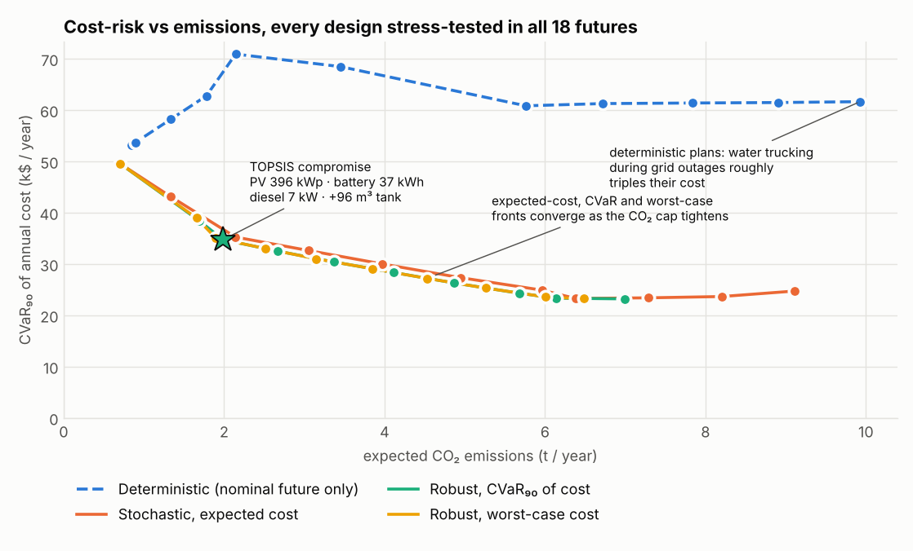
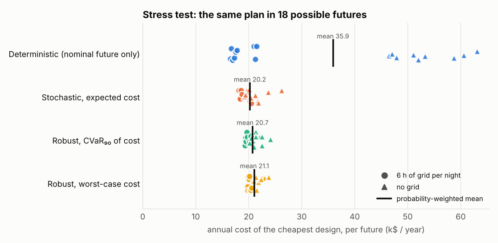

# robust-moo-water-energy

**Planning a solar-powered water supply that still works when the future goes wrong.**
A scenario-based robust multi-objective optimisation framework (SBR-MOA) in Python, Pyomo and
the open-source HiGHS solver. It sizes PV, batteries, a diesel back-up and water storage for a
borehole station under 18 combinations of climate change, diesel prices and grid outages, then
trades off cost risk against CO₂ emissions.

[](https://github.com/Mohammedgmail/robust-moo-water-energy/actions/workflows/ci.yml)


> **Companion code** to M. Alfandi & S. U. Seçkiner, *A scenario-based robust multi-objective
> framework for climate-resilient water-energy systems in conflict-affected regions*,
> Journal of Cleaner Production 577 (2026) 149516,
> [doi:10.1016/j.jclepro.2026.149516](https://doi.org/10.1016/j.jclepro.2026.149516).
> This repository is an independent, simplified open implementation of the approach, run on an
> **illustrative** single-station case study. Its numbers do not reproduce the paper's results.



## Why

Water stations in northwest Syria pump from deep boreholes with diesel, an intermittent grid and,
increasingly, solar PV. A plan sized for one "most likely" future is fragile: warming raises
demand and lowers the water table, fuel prices swing, and in conflict-affected areas the grid can
disappear overnight. This framework designs the system once (here-and-now) and lets it operate
optimally in every scenario (wait-and-see), so you can see what a design costs in the futures you
did not plan for, and how much protection against them is worth.

## Results on the illustrative case study

Each design below is stress-tested by operating it cost-optimally in all 18 scenarios.

| Planning approach | PV (kWp) | Battery (kWh) | Diesel (kW) | Extra tank (m³) | Expected cost | CVaR₉₀ cost | Worst cost | Expected CO₂ |
|---|--:|--:|--:|--:|--:|--:|--:|--:|
| Deterministic (nominal future only) | 155 | 18 | 5 | 127 | $35.9k/yr | $61.6k/yr | $63.1k/yr | 9.9 t |
| Stochastic, expected cost | 171 | 29 | 19 | 115 | **$20.2k/yr** | $24.7k/yr | $26.2k/yr | 9.1 t |
| **Robust, CVaR₉₀** | 179 | 46 | 19 | 118 | $20.7k/yr | **$23.2k/yr** | $24.1k/yr | 7.0 t |
| Robust, worst case | 184 | 56 | 19 | 106 | $21.1k/yr | $23.2k/yr | **$23.7k/yr** | 6.5 t |
| Robust, CVaR₉₀, TOPSIS compromise | 396 | 37 | 7 | 96 | $33.3k/yr | $34.7k/yr | $35.0k/yr | **2.0 t** |



**What the case study shows**

- **Planning for one future is expensive.** The cheapest deterministic plan costs $17.5k/yr in the
  future it was sized for, but 2.7–3.6 times that whenever the grid is down, because it must
  truck up to 3.7 % of the station's water. Averaged over all futures it costs $15.7k/yr more
  than the stochastic plan (the *value of the stochastic solution*).
- **Robustness is cheap.** Compared with the risk-neutral (expected-cost) plan, the CVaR plan
  costs 2.5 % more on average but cuts the worst-case cost by 7.8 % and emissions by 23 %:
  more battery and PV make it less exposed to diesel prices.
- **Decarbonisation and robustness pull the same way.** As the CO₂ cap tightens, the
  expected-cost, CVaR and worst-case fronts converge: PV-heavy systems are naturally insensitive
  to fuel prices and outages.
- **A balanced choice.** With equal weights on cost-risk and emissions, TOPSIS picks a
  396 kWp PV design that cuts emissions by 72 % for 60 % more expected cost than the cheapest
  robust plan.

## The method

| Step | What happens | Where |
|---|---|---|
| 1. Scenarios | 3 climate pathways (warming, demand, water-table decline) x 3 diesel prices x 2 grid regimes = 18 weighted futures; hourly representative days (summer, winter, dust storm) | `data.py`, `data/*.yaml` |
| 2. Two-stage model | First stage: PV, battery, diesel and tank sizes. Second stage, per scenario and hour: pumping, PV use, battery, diesel, grid, tank level, trucking. Linear programme | `model.py` |
| 3. Robust objective | Expected cost, **CVaR**ₐ (Rockafellar–Uryasev linearisation) or worst-case cost; reliability ≥ 95 % of demand enforced in **every** scenario | `model.py` |
| 4. Pareto front | Augmented ε-constraint (AUGMECON, Mavrotas 2009) on risk-adjusted cost vs expected CO₂, with a lexicographic payoff table | `pareto.py` |
| 5. Decision | TOPSIS (or knee point) selects a compromise design | `decision.py` |
| 6. Stress test | Fix a design and operate it in every scenario, with no reliability constraint: shortfalls are trucked and reported | `evaluate.py` |

CVaR₉₀ is the average cost of the worst 10 % of futures:

$$\mathrm{CVaR}_\alpha = \min_{\eta}\; \eta + \frac{1}{1-\alpha}\sum_s p_s \max(0,\ \text{cost}_s - \eta)$$

which stays linear, so the whole problem remains an LP. A full Pareto front of 11 points over
18 scenarios (about 13,000 variables and 17,000 constraints per solve) takes about 6 seconds.

## Quick start

Python 3.10–3.13. On a Mac: `brew install python@3.12`.

```bash
git clone https://github.com/Mohammedgmail/robust-moo-water-energy.git
cd robust-moo-water-energy
python3.12 -m venv .venv && source .venv/bin/activate
pip install -e ".[dev]"            # Pyomo, HiGHS (via highspy), pandas, matplotlib
pytest -q                          # 22 tests
python scripts/run_case_study.py   # about 1 minute -> results/*.csv
python scripts/plot_results.py     # -> docs/*.png
```

Use it on your own station by copying `data/nws_borehole_station.yaml` and editing the
parameters, or from Python:

```python
import pyomo.environ as pyo
from sbrmoa.data import load_case
from sbrmoa.model import build_model, solve, design_of
from sbrmoa.evaluate import evaluate_design

case = load_case("data/nws_borehole_station.yaml")
m = build_model(case, risk="cvar", alpha=0.9)
m.obj = pyo.Objective(expr=m.cost_objective)
solve(m)
per_scenario, summary = evaluate_design(case, design_of(m))
print(design_of(m), summary)
```

## Case-study assumptions (illustrative)

One borehole station serving about 20,000 people (600 m³/day base demand), 150 m pumping head,
an 80 m³/h pump and a 200 m³ existing tank. Climate pathways for 2050 add 1.0–2.4 °C of warming,
4–11 % more demand and 8–25 m of water-table decline. Diesel costs $0.80–1.50/L, and the grid is
either absent or live for 6 hours a night. Costs are annualised at 8 % over each technology's
life. All values are in [`data/nws_borehole_station.yaml`](data/nws_borehole_station.yaml) with
units and comments. They are engineering assumptions chosen to be plausible, **not** field data
or the paper's data.

## Limitations

- Linear model: a constant diesel fuel rate (no part-load curve or unit commitment), and three
  representative days instead of a full year.
- A single station; the pump size is fixed and the network is not modelled.
- Scenario probabilities are assumptions; under deep uncertainty, compare the worst-case and
  CVaR results rather than relying on the expected value alone.

## Roadmap

- [ ] Reliability as a third objective (three-objective AUGMECON2)
- [ ] Min-max regret as an additional robustness measure
- [ ] Scenario generation from downscaled CMIP6 data
- [ ] Multi-station networks and pump sizing (MILP)

## Project layout

```
src/sbrmoa/
  data.py       # parameters, representative days, scenario tree
  model.py      # two-stage LP and risk measures
  pareto.py     # payoff table and AUGMECON
  decision.py   # TOPSIS and knee point
  evaluate.py   # stress-testing fixed designs, discrete CVaR
data/           # case-study parameters (YAML)
scripts/        # run_case_study.py, plot_results.py
results/        # Pareto fronts, design comparison, per-scenario stress test (CSV)
tests/          # pytest suite
```

## References

- M. Alfandi, S. U. Seçkiner, Journal of Cleaner Production 577 (2026) 149516.
- M. Alfandi, S. U. Seçkiner, "Renewable energy and greenhouse gas reduction for water supply in conflict-affected Syria", Renewable and Sustainable Energy Reviews 211 (2025) 115353.
- R. T. Rockafellar, S. Uryasev, "Optimization of conditional value-at-risk", *Journal of Risk*, 2000.
- G. Mavrotas, "Effective implementation of the ε-constraint method in multi-objective mathematical programming problems", *Applied Mathematics and Computation*, 2009.
- C.-L. Hwang, K. Yoon, *Multiple Attribute Decision Making*, Springer, 1981 (TOPSIS).
- Q. Huangfu, J. A. J. Hall, "Parallelizing the dual revised simplex method", *Mathematical Programming Computation*, 2018 (HiGHS).

## Author

**Mohammed Alfandi** · MSc Robotics & AI, Newcastle University ·
[LinkedIn](https://linkedin.com/in/mohammed-alfandi/) · [ResearchGate](https://researchgate.net/profile/Mohammed-Alfandi/)

Released under the [MIT License](LICENSE). If you use the method, please cite the paper ([CITATION.cff](CITATION.cff)).
